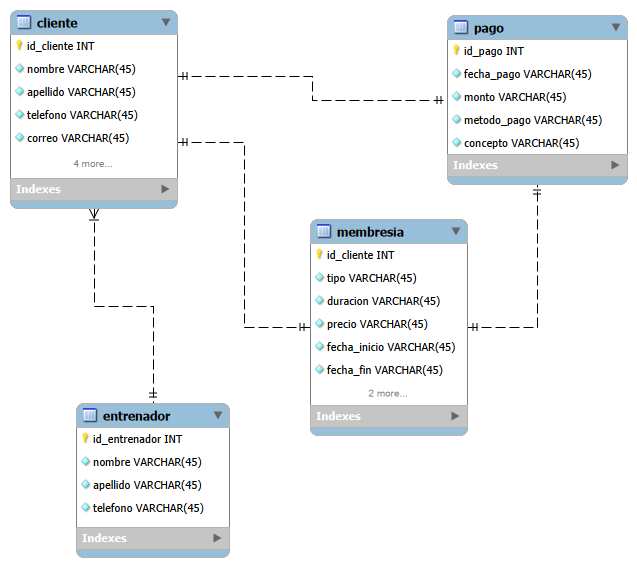

# Base de Datos GYM

## Descripción

La base de datos **GYM** está diseñada para gestionar la información básica de un gimnasio. Permite registrar a los clientes, sus membresías, los pagos realizados y los entrenadores asignados.

La base de datos está compuesta por cuatro tablas principales:

- **Cliente:** almacena la información personal y de registro de los clientes.
- **Membresía:** contiene la información de la membresía de cada cliente, como el tipo, duración, precio y estado.
- **Pago:** registra los pagos realizados, incluyendo la fecha, monto, método de pago y concepto.
- **Entrenador:** almacena la información de los entrenadores del gimnasio.

### Relaciones principales

- Un **entrenador** puede atender a varios **clientes**.
- Un **cliente** tiene una **membresía**.
- Un **cliente** puede realizar varios **pagos**.
- Una **membresía** puede estar relacionada con varios **pagos**.

---

## Diagrama Entidad-Relación



---

## Estructura de la Base de Datos

### Tabla `cliente`

Contiene la información de los clientes registrados en el gimnasio.

| Campo | Tipo | Descripción |
|---|---|---|
| `id_cliente` | INT | Identificador único del cliente |
| `nombre` | VARCHAR(45) | Nombre del cliente |
| `apellido` | VARCHAR(45) | Apellido del cliente |
| `telefono` | VARCHAR(45) | Número telefónico |
| `correo` | VARCHAR(45) | Correo electrónico |
| `fecha_registro` | VARCHAR(45) | Fecha en que se registró |
| `membresia_id_cliente` | INT | Referencia a la membresía |
| `pago_id_pago` | INT | Referencia al pago |
| `entrenador_id_entrenador` | INT | Referencia al entrenador |

### Tabla `membresia`

Contiene la información de las membresías de los clientes.

| Campo | Tipo | Descripción |
|---|---|---|
| `id_cliente` | INT | Identificador de la membresía |
| `tipo` | VARCHAR(45) | Tipo de membresía |
| `duracion` | VARCHAR(45) | Duración de la membresía |
| `precio` | VARCHAR(45) | Precio de la membresía |
| `fecha_inicio` | VARCHAR(45) | Fecha de inicio |
| `fecha_fin` | VARCHAR(45) | Fecha de finalización |
| `estado` | VARCHAR(45) | Estado de la membresía |
| `pago_id_pago` | INT | Referencia al pago |

### Tabla `pago`

Registra los pagos realizados dentro del gimnasio.

| Campo | Tipo | Descripción |
|---|---|---|
| `id_pago` | INT | Identificador único del pago |
| `fecha_pago` | VARCHAR(45) | Fecha del pago |
| `monto` | VARCHAR(45) | Cantidad pagada |
| `metodo_pago` | VARCHAR(45) | Método utilizado para pagar |
| `concepto` | VARCHAR(45) | Concepto del pago |

### Tabla `entrenador`

Contiene la información de los entrenadores.

| Campo | Tipo | Descripción |
|---|---|---|
| `id_entrenador` | INT | Identificador único del entrenador |
| `nombre` | VARCHAR(45) | Nombre del entrenador |
| `apellido` | VARCHAR(45) | Apellido del entrenador |
| `telefono` | VARCHAR(45) | Número telefónico |

---

## Código SQL

```sql
-- MySQL Workbench Forward Engineering

SET @OLD_UNIQUE_CHECKS=@@UNIQUE_CHECKS, UNIQUE_CHECKS=0;
SET @OLD_FOREIGN_KEY_CHECKS=@@FOREIGN_KEY_CHECKS, FOREIGN_KEY_CHECKS=0;
SET @OLD_SQL_MODE=@@SQL_MODE, SQL_MODE='ONLY_FULL_GROUP_BY,STRICT_TRANS_TABLES,NO_ZERO_IN_DATE,NO_ZERO_DATE,ERROR_FOR_DIVISION_BY_ZERO,NO_ENGINE_SUBSTITUTION';

-- -----------------------------------------------------
-- Schema gym
-- -----------------------------------------------------

CREATE SCHEMA IF NOT EXISTS `gym` DEFAULT CHARACTER SET utf8 ;
USE `gym` ;

-- -----------------------------------------------------
-- Table `gym`.`pago`
-- -----------------------------------------------------
CREATE TABLE IF NOT EXISTS `gym`.`pago` (
  `id_pago` INT NOT NULL,
  `fecha_pago` VARCHAR(45) NOT NULL,
  `monto` VARCHAR(45) NOT NULL,
  `metodo_pago` VARCHAR(45) NOT NULL,
  `concepto` VARCHAR(45) NOT NULL,
  PRIMARY KEY (`id_pago`))
ENGINE = InnoDB;


-- -----------------------------------------------------
-- Table `gym`.`membresia`
-- -----------------------------------------------------
CREATE TABLE IF NOT EXISTS `gym`.`membresia` (
  `id_cliente` INT NOT NULL,
  `tipo` VARCHAR(45) NOT NULL,
  `duracion` VARCHAR(45) NOT NULL,
  `precio` VARCHAR(45) NOT NULL,
  `fecha_inicio` VARCHAR(45) NOT NULL,
  `fecha_fin` VARCHAR(45) NOT NULL,
  `estado` VARCHAR(45) NOT NULL,
  `pago_id_pago` INT NOT NULL,
  PRIMARY KEY (`id_cliente`),
  INDEX `fk_membresia_pago1_idx` (`pago_id_pago` ASC) VISIBLE,
  CONSTRAINT `fk_membresia_pago1`
    FOREIGN KEY (`pago_id_pago`)
    REFERENCES `gym`.`pago` (`id_pago`)
    ON DELETE NO ACTION
    ON UPDATE NO ACTION)
ENGINE = InnoDB;


-- -----------------------------------------------------
-- Table `gym`.`entrenador`
-- -----------------------------------------------------
CREATE TABLE IF NOT EXISTS `gym`.`entrenador` (
  `id_entrenador` INT NOT NULL,
  `nombre` VARCHAR(45) NOT NULL,
  `apellido` VARCHAR(45) NOT NULL,
  `telefono` VARCHAR(45) NOT NULL,
  PRIMARY KEY (`id_entrenador`))
ENGINE = InnoDB;


-- -----------------------------------------------------
-- Table `gym`.`cliente`
-- -----------------------------------------------------
CREATE TABLE IF NOT EXISTS `gym`.`cliente` (
  `id_cliente` INT NOT NULL,
  `nombre` VARCHAR(45) NOT NULL,
  `apellido` VARCHAR(45) NOT NULL,
  `telefono` VARCHAR(45) NOT NULL,
  `correo` VARCHAR(45) NOT NULL,
  `fecha_registro` VARCHAR(45) NOT NULL,
  `membresia_id_cliente` INT NOT NULL,
  `pago_id_pago` INT NOT NULL,
  `entrenador_id_entrenador` INT NOT NULL,
  PRIMARY KEY (`id_cliente`),
  INDEX `fk_cliente_membresia_idx` (`membresia_id_cliente` ASC) VISIBLE,
  INDEX `fk_cliente_pago1_idx` (`pago_id_pago` ASC) VISIBLE,
  INDEX `fk_cliente_entrenador1_idx` (`entrenador_id_entrenador` ASC) VISIBLE,
  CONSTRAINT `fk_cliente_membresia`
    FOREIGN KEY (`membresia_id_cliente`)
    REFERENCES `gym`.`membresia` (`id_cliente`)
    ON DELETE NO ACTION
    ON UPDATE NO ACTION,
  CONSTRAINT `fk_cliente_pago1`
    FOREIGN KEY (`pago_id_pago`)
    REFERENCES `gym`.`pago` (`id_pago`)
    ON DELETE NO ACTION
    ON UPDATE NO ACTION,
  CONSTRAINT `fk_cliente_entrenador1`
    FOREIGN KEY (`entrenador_id_entrenador`)
    REFERENCES `gym`.`entrenador` (`id_entrenador`)
    ON DELETE NO ACTION
    ON UPDATE NO ACTION)
ENGINE = InnoDB;


SET SQL_MODE=@OLD_SQL_MODE;
SET FOREIGN_KEY_CHECKS=@OLD_FOREIGN_KEY_CHECKS;
SET UNIQUE_CHECKS=@OLD_UNIQUE_CHECKS;
```